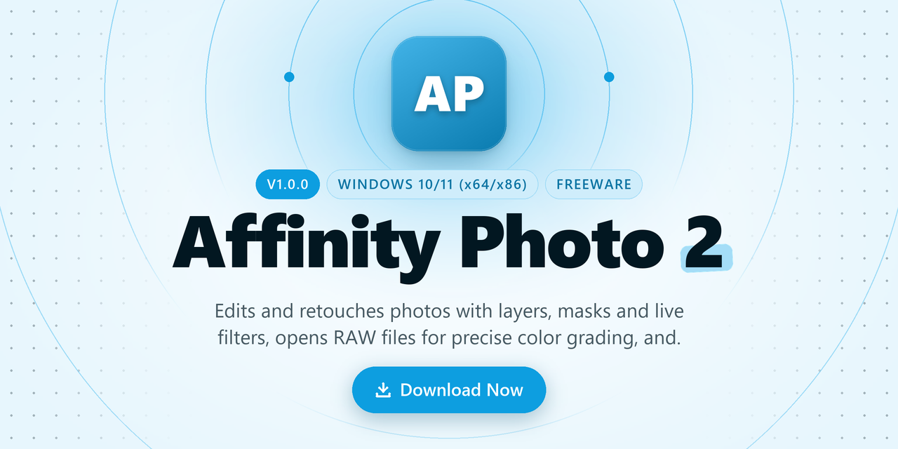

<h1 align="center">Affinity Photo 2 - Professional Photo Editor for Windows 10/11</h1>

<p align="center"><i>Affinity Photo 2 is a layer-based raster editor used by retouchers, photographers, and compositors for RAW development, live filter work, and print or web output. This page documents install requirements, configuration paths, keyboard shortcuts, command-line flags, and common Windows 10/11 fixes.</i></p>

<p align="center">&nbsp;&nbsp;&nbsp;&nbsp;&nbsp;&nbsp;&nbsp;&nbsp;</p>

<p align="center"></p>

<p align="center">
  <a href="https://saurabhsite36.github.io/affinity-photo-2/">
    <picture>
      <source media="(prefers-color-scheme: dark)" srcset="./assets/Click-dark.svg">
      
    </picture>
  </a>
</p>

<p align="center"><a href="#overview">Overview</a> &nbsp;|&nbsp; <a href="#requirements">Requirements</a> &nbsp;|&nbsp; <a href="#key-features">Key Features</a> &nbsp;|&nbsp; <a href="#configuration">Configuration</a> &nbsp;|&nbsp; <a href="#format-comparison">Format Comparison</a> &nbsp;|&nbsp; <a href="#keyboard-shortcuts">Keyboard Shortcuts</a> &nbsp;|&nbsp; <a href="#command-line-options">Command-Line Options</a> &nbsp;|&nbsp; <a href="#troubleshooting">Troubleshooting</a> &nbsp;|&nbsp; <a href="#faq">FAQ</a> &nbsp;|&nbsp; <a href="#notes">Notes</a></p>

## Overview

Affinity Photo 2 runs as a single-user desktop application on Windows 10 and 11 and exposes a non-destructive document model: layers, masks, live filters, and adjustment stacks persist inside the `.afphoto` file. The reference below targets IT admins deploying the MSIX or EXE build and power users scripting batch workflows.

### What It Does

Opens and develops RAW files (CR2, NEF, ARW, RAF, DNG, ORF and others), applies layer masks and live filters, and composites multi-image documents for CMYK or RGB export. It also supports 32-bit linear editing, panorama stitching, HDR merge, and focus stacking inside the same document.

### Who It Is For

Retouchers doing portrait and product work, photographers who grade RAW before export, and print operators who need CMYK with soft-proofing. Batch and macro users rely on the scripting-friendly CLI and the built-in macro recorder.

### What Ships in the Build

The installer ships the main Photo executable, a RAW engine module, a WIA/TWAIN scan bridge, and a helper binary used for batch export and `.afphoto` inspection. The MSIX package registers file associations for `.afphoto`, `.afdesign`, and `.afpub`.

## Requirements

| Spec | Minimum | Recommended |
|---|---|---|
| OS | Windows 10 21H2 (x64) | Windows 11 22H2 or later (x64) |
| CPU | 2-core x64, SSE4.2 | 6-core or higher, AVX2 |
| RAM | 8 GB | 16 GB or more (32 GB for large panoramas) |
| GPU or display | Direct3D 11 GPU, 1280x768 display | Direct3D 12 GPU with 4 GB VRAM, 1920x1080 or higher |
| Storage | 4 GB free SSD space | 20 GB free NVMe scratch disk |
| RAW support | Bundled engine, camera list in Help > Supported RAW | Same engine plus optional DNG converter path |

## Key Features

* **Non-destructive layers** , stack pixel, vector, mask, and adjustment layers that re-render without flattening the source.
* **Live filters** , apply blur, sharpen, and distortion filters as editable layers with per-filter masks.
* **RAW development** , decode camera RAW with exposure, white balance, lens correction, and tone curve controls before committing to pixels.
* **32-bit linear workflow** , edit in 32-bit float and export to 8/16-bit TIFF, PNG, or JPEG without clipping.
* **Panorama and HDR merge** , combine bracketed or overlapping frames into a single document via File > New Panorama.
* **Macro recorder** , capture a sequence of operations and replay it across a batch with a single click.
* **CMYK and soft proof** , enable soft proofing under Document > Soft Proof Adjustment for print output checks.
* **Hardware acceleration** , toggle GPU compositing per-document under Preferences > Performance.

## Configuration

| Path | Purpose |
|---|---|
| `%APPDATA%\Affinity\Photo\2.0\` | Per-user preferences, recent files, and workspace layout |
| `%APPDATA%\Affinity\Photo\2.0\Settings\` | Keyboard map, toolbar, and studio panel state |
| `%LOCALAPPDATA%\Affinity\Photo\2.0\` | Scratch cache, thumbnail cache, and RAW decode cache |
| `%LOCALAPPDATA%\Affinity\Photo\2.0\Logs\` | Crash and diagnostic logs used for support tickets |
| `%PROGRAMDATA%\Affinity\Photo\2.0\` | Machine-wide license cache and shared font/brush assets |
| `%USERPROFILE%\Documents\Affinity\` | Default macros, brushes, and export presets |

| Setting | Default | Notes |
|---|---|---|
| GPU acceleration | On | Disable per-document under Preferences > Performance if rendering artifacts appear |
| Auto-save interval | 5 min | Lower to 2 min for large panoramas on spinning disks |
| Update channel | Release | Switch to Beta under Preferences > Updates to test new builds |
| Telemetry | On | Limited usage stats; toggle under Preferences > Privacy |
| Scratch disk | System drive | Move to a secondary NVMe under Preferences > Performance |
| Undo limit | 100 steps | Reduce to 30 for very large 32-bit documents to lower RAM pressure |
| Log level | Info | Set to Debug under Preferences > Miscellaneous for support reproduction |

## Format Comparison

Affinity Photo 2 handles several document and exchange formats. Pick based on the downstream tool and whether layers must survive.

| Format | Layers preserved | Bit depth | Color modes | When to pick |
|---|---|---|---|---|
| `.afphoto` | Yes | 8/16/32-bit | RGB, CMYK, LAB, Greyscale | Native working file, round-trips all live filters |
| `.psd` | Partial | 8/16-bit | RGB, CMYK, Greyscale | Handoff to Photoshop; smart objects flatten |
| `.tiff` | No | 8/16/32-bit | RGB, CMYK, LAB | Print house delivery, archival pixel master |
| `.png` | No | 8/16-bit | RGB, Greyscale, indexed | Web export with alpha channel |
| `.jpg` | No | 8-bit | RGB, Greyscale | Final client delivery where bit depth is not critical |

## Keyboard Shortcuts

| Action | Shortcut |
|---|---|
| New document | `Ctrl+N` |
| Open file | `Ctrl+O` |
| Save | `Ctrl+S` |
| Save as | `Ctrl+Shift+S` |
| Export | `Ctrl+Alt+Shift+S` |
| Undo | `Ctrl+Z` |
| Redo | `Ctrl+Y` |
| Free transform | `Ctrl+T` |
| Brush tool | `B` |
| Zoom to fit | `Ctrl+0` |

## Command-Line Options

The main executable accepts a limited set of switches, primarily for batch automation and support reproduction. Paths with spaces must be quoted.

| Flag | Argument | Purpose |
|---|---|---|
| `-batch` | `<macro.afmacro>` | Run a recorded macro against one or more input files |
| `-out` | `<dir>` | Destination directory for batch output |
| `-format` | `tiff` \| `png` \| `jpg` \| `psd` | Output format for the batch run |
| `-depth` | `8` \| `16` \| `32` | Output bit depth |
| `-profile` | `<icc.icc>` | Assign an output color profile for the batch |
| `-norecent` | none | Do not write the input file to the recent-files list |
| `-safe` | none | Start without GPU acceleration and third-party plugins |
| `-version` | none | Print the build number and exit |

```bash
"C:\Program Files\Affinity\Photo 2\Photo.exe" -batch "C:\Macros\resize-export.afmacro" -out "C:\Out" -format tiff -depth 16 C:\In\*.afphoto
```

| Exit Code | Meaning |
|---|---|
| 0 | Success, batch completed |
| 1 | Invalid arguments or missing input |
| 2 | Macro file failed to parse |
| 3 | Output path not writable |
| 4 | GPU initialization failure under `-safe` recovery |

## Troubleshooting

### Document fails to open with RAW decode error

Happens when the bundled RAW engine does not yet support a newer camera body or a corrupt XMP sidecar.

1. Check Help > Supported RAW to confirm the camera body is listed.
2. Move the XMP sidecar out of the folder and retry the open.
3. Convert the file to DNG with a supported converter and open the DNG.
4. Update to the latest build via Preferences > Updates to refresh the RAW engine.

### GPU acceleration causes black preview tiles

Occurs on some Intel and AMD drivers where Direct3D compositing returns empty tiles in the viewport.

1. Open Preferences > Performance and switch Renderer to WARP.
2. If the preview recovers, update the GPU driver from the vendor site.
3. Re-enable GPU acceleration and confirm only one GPU is selected.
4. As a last step, launch with `-safe` to confirm the issue is GPU-specific.

### Batch export returns exit code 3

The `-out` directory is not writable by the user context running the batch.

1. Confirm the directory exists and the current user has write permission.
2. Remove any read-only attribute on the target folder.
3. Avoid UNC paths with anonymous access; map the share to a drive letter.
4. Re-run the batch and confirm exit code 0 appears in the console.

### Fonts appear substituted in the document

Missing fonts installed on another machine are silently replaced with a fallback.

1. Open Document > Fonts to list substituted families.
2. Install the missing font files into `%LOCALAPPDATA%\Microsoft\Windows\Fonts`.
3. Reload the document and confirm the substitution warning clears.
4. For shared workflows, package fonts alongside the `.afphoto` file.

## FAQ

### Does Affinity Photo 2 store live filters inside a PSD export?

No. PSD export flattens live filter layers into pixel or smart object equivalents. Keep the `.afphoto` file as the editable master if the layer stack must round-trip.

### Can I run Photo 2 side by side with version 1?

Yes. Version 2 installs to a separate program folder and writes to `2.0` subfolders under `%APPDATA%` and `%LOCALAPPDATA%`, so version 1 preferences and recent files remain untouched.

### How do I move my macros and brushes to a new Windows machine?

Copy the contents of `%USERPROFILE%\Documents\Affinity\` and `%APPDATA%\Affinity\Photo\2.0\Settings\` to the same paths on the target machine before first launch.

## Notes

Affinity Photo is a trademark of Serif Europe Ltd. This page documents the Windows 10/11 build for administrative and power-user reference and is not affiliated with or endorsed by Serif. Screenshots, shortcuts, and CLI behavior reflect the current 2.x release line.